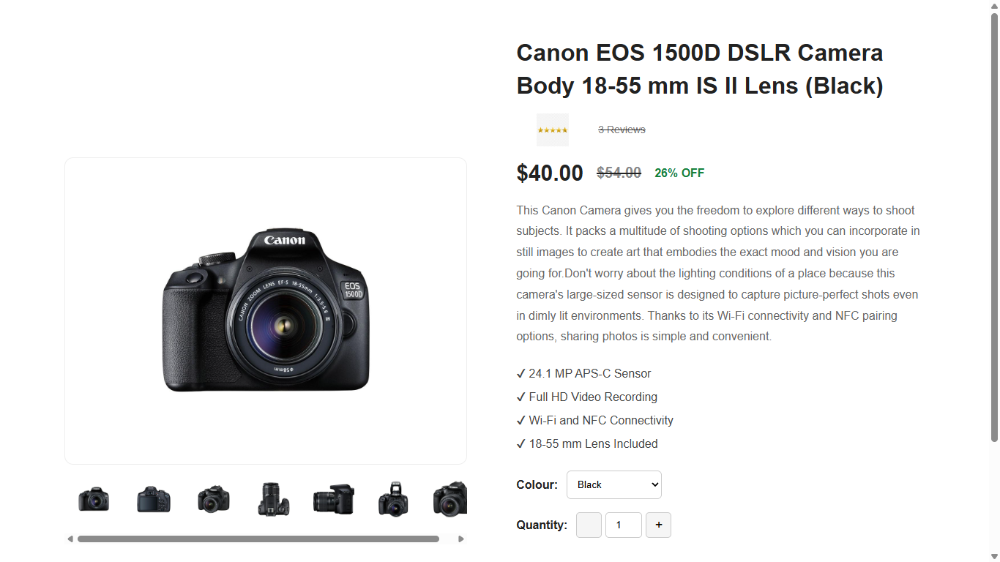
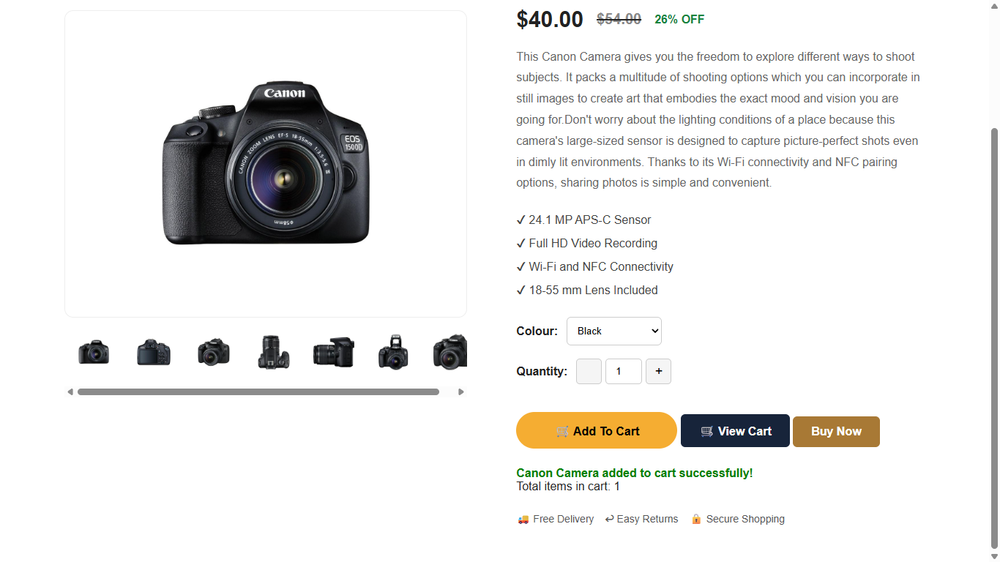
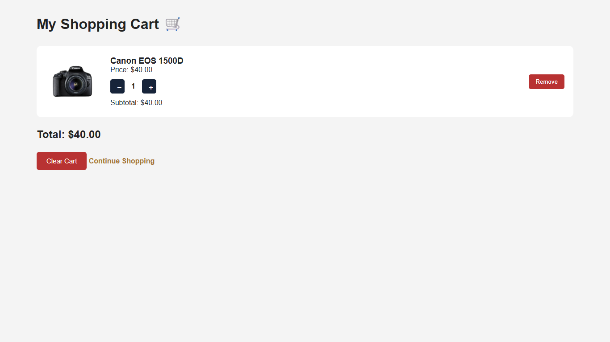
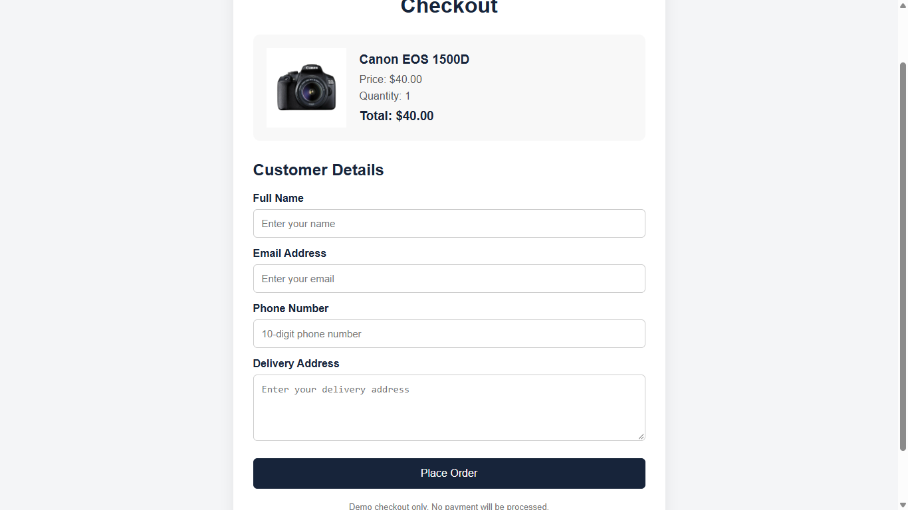
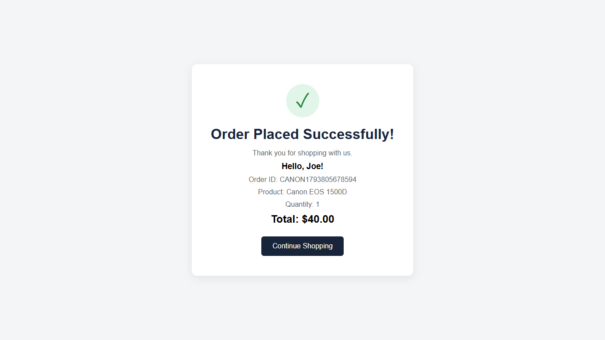

# 📷 Canon Camera – E-commerce Website

A responsive front-end e-commerce website for the **Canon EOS 1500D DSLR Camera**, built using HTML, CSS and JavaScript.

## 🌐 Live Website

### [🚀 Visit Canon Camera Website](https://kamalitherasar.github.io/Canon-Camera/)

Explore the live project and experience the shopping flow!

## ✨ Features

- **Product Home Page:** Displays Canon EOS 1500D product details.
- **Image Gallery:** Switch between product images using thumbnails.
- **Image Zoom:** View product images more closely.
- **Quantity Selection:** Increase or decrease product quantity.
- **Add to Cart:** Add products to the shopping cart.
- **Cart Management:** Update quantities, remove products and clear the cart.
- **Cart Count:** Displays the total number of items.
- **Buy Now:** Proceed directly to checkout.
- **Checkout Page:** Enter customer and delivery details.
- **Order Confirmation:** Displays a demo order confirmation.
- **Responsive Design:** Supports desktop and mobile screens.
- **Local Storage:** Stores cart and demo order information in the browser.

## 🛠️ Technologies Used

- HTML5
- CSS3
- JavaScript
- Browser Local Storage
- Git and GitHub

## 📸 Project Screenshots

### 1. Home Page – Canon Camera



### 2. Product Added Successfully



### 3. Shopping Cart Page



### 4. Checkout Page



### 5. Order Success Page



## 📂 Project Structure

```text
Canon-Camera/
│
├── index.html
├── cam.css
├── cam.js
│
├── cart.html
├── cart.css
├── cart.js
│
├── checkout.html
├── checkout.css
│
├── success.html
├── success.css
│
├── favicon.ico
├── images/
├── screenshots/
│   ├── cam-home.png
│   ├── added-successfully.png
│   ├── cart.png
│   ├── checkout.png
│   └── success.png
│
└── README.md
```

## 💻 Run Locally

1. Clone the repository:

   ```bash
   git clone https://github.com/KamalitherasaR/Canon-Camera.git
   ```

2. Open the project folder in VS Code.
3. Open `index.html` using Live Server.
4. Explore the website.

## ⚠️ Project Note

This is a frontend demonstration project. It does not include backend integration, real order processing or online payment functionality. Cart and demo order information are stored using browser Local Storage.

## 👩‍💻 Author

**KamalitherasaR**

- GitHub: [KamalitherasaR](https://github.com/KamalitherasaR)
- Live Project: [Canon Camera E-commerce Website](https://kamalitherasar.github.io/Canon-Camera/)

---

⭐ If you like this project, consider giving the repository a star!
